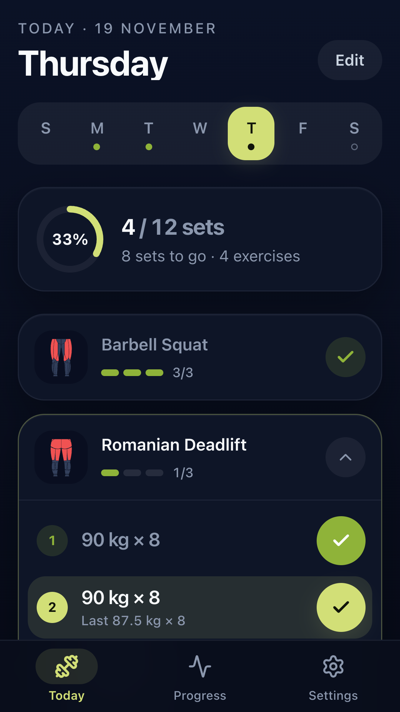
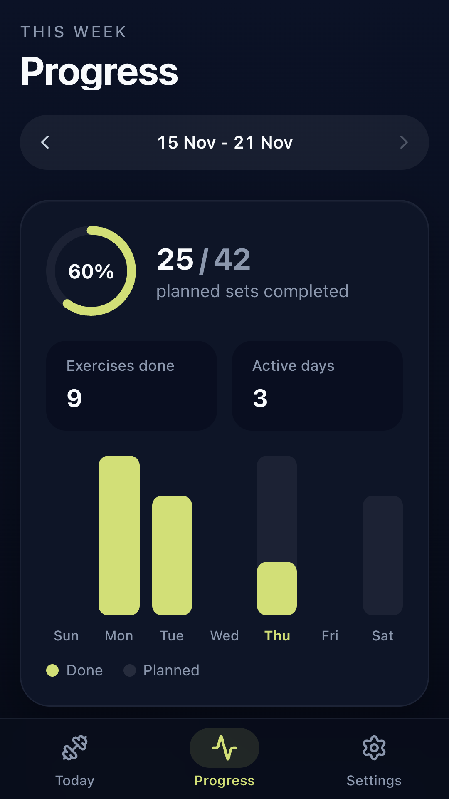
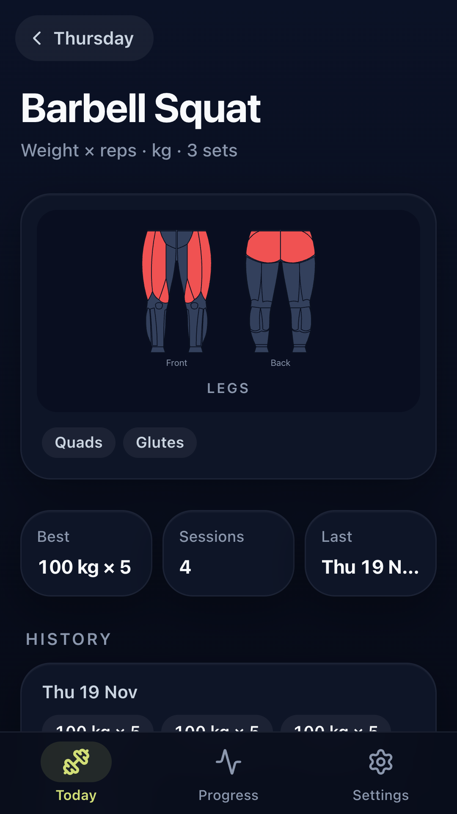
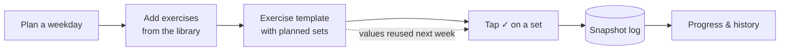

<p align="center">
  
</p>

<h1 align="center">GymTrack</h1>

<p align="center">
  A minimal, offline-first workout tracker. Plan your weekly split, log each set with one tap, and watch your progress. Everything stays on your device.
</p>

<p align="center">
  <strong>React 19</strong> · <strong>TypeScript</strong> · <strong>Vite 8</strong> · <strong>Dexie (IndexedDB)</strong> · <strong>Tailwind CSS 4</strong> · <strong>PWA</strong>
</p>

| Today | Progress | Exercise |
| --- | --- | --- |
|  |  |  |

## Features

- **One-tap logging.** Sets are prefilled from your plan. Tap ✓ to log one, or tap the numbers to adjust them with +/− steppers. When an exercise is done, the next one opens automatically.
- **Weekly plan.** Each weekday has its own exercises, and the S–M–T–W–T–F–S strip doubles as this week's progress overview.
- **Exercise library.** Search 54 built-in exercises, add one with a single tap, or create your own. Re-adding an exercise reuses your last weights.
- **Muscle maps.** Every exercise shows the muscles it targets on a body diagram.
- **Progress.** Weekly and monthly sets done, volume, active days, the muscles you trained, and your best set per exercise.
- **Honest history.** Each completed set is stored as an immutable snapshot, so changing your plan never rewrites the past.
- **Works offline and installs like an app** on Android, iOS and desktop. There's no account and no server.

## Quick start

You need **Node 22.12+** (or 20.19+). The project uses **Yarn 1**, which ships with Node through Corepack:

```bash
corepack enable
yarn install
yarn dev            # http://localhost:5173
```

### Scripts

| Command | What it does |
| --- | --- |
| `yarn dev` | Dev server with hot reload (service worker disabled) |
| `yarn build` | Type-check and build the production bundle into `dist/` |
| `yarn preview` | Serve `dist/` locally |
| `yarn test` / `yarn test:watch` | Run the Vitest suite once / in watch mode |
| `yarn lint` | ESLint |
| `yarn typecheck` | TypeScript only |
| `yarn verify` | Type-check, lint and test in one go; run before pushing |
| `yarn pwa:icons` | Regenerate favicon and app icons from `public/logo.svg` (needs Chrome) |
| `yarn pwa:screenshots` | Re-capture `public/screenshots/` from the real app with demo data (needs Chrome) |

## How it works



- **Templates** (`exercises`) hold what you plan to do on each weekday, and are reused every week.
- **Logs** (`workoutlogs`) are what you actually did. Each is an immutable snapshot of one set, recorded at most once per day.
- Progress, history and "last time" values are all derived from the logs.

## Architecture

```
src/
├─ app/        Router (lazy screens), layout, navigation, theme, PWA registration
├─ features/   workout-day · add-exercise · exercise-detail · progress · settings · pwa
├─ data/       Dexie database, migrations, repositories, seed loaders
├─ domain/     Types and pure logic (dates, sets, history, progress), unit-tested
└─ shared/     UI primitives, muscle-map SVGs, small helpers
```

Dependencies point one way: `shared ← domain ← data ← features ← app`. Screens read through feature hooks (`useWorkoutDay`, `useProgress`, …) that wrap Dexie live queries, so the UI updates by itself whenever data changes. Writes are plain repository calls.

**Full guide:** [docs/ARCHITECTURE.md](docs/ARCHITECTURE.md). It covers layers, data flow, the data model, domain rules, testing, and how to add screens, fields and migrations.

## Deployment

The app is a static site, configured for **Netlify** in `netlify.toml`:
- **Build:** tests run first, then the build, on Node 22.
- **Routing:** the SPA fallback is set up.
- **Security headers:** a CSP and related headers are included.
- **Caching:** `index.html`, `sw.js` and the manifest are never cached, so updates reach users; hashed assets are cached for a year.

Connect the repo in Netlify and deploy; no settings or environment variables are needed. Details and troubleshooting are in [docs/DEPLOYMENT.md](docs/DEPLOYMENT.md).

## Data and privacy

All data is stored in your browser's IndexedDB (database `GymTrack`) and never leaves the device. Clearing site data, uninstalling the app or switching browsers starts fresh. There's no export or sync yet.

## Contributing

- Run `yarn verify` before pushing.
- Keep business logic in `src/domain/` (pure and tested) and database access in `src/data/repositories/`.
- `workoutlogs` are append-only snapshots. Never rewrite history when templates change.
- Schema changes need a **new** Dexie version in `src/data/db.ts`; never edit an old one.

[AGENT.md](AGENT.md) is a condensed brief for AI coding assistants.
