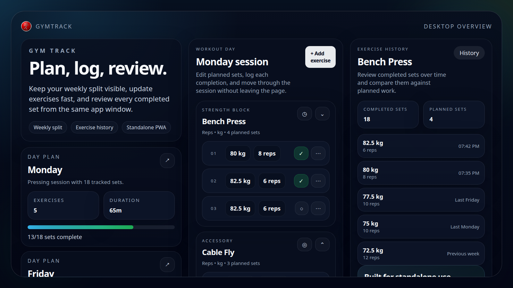
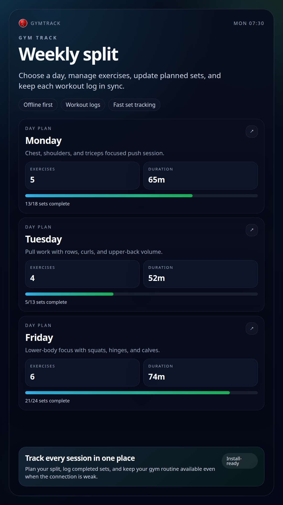
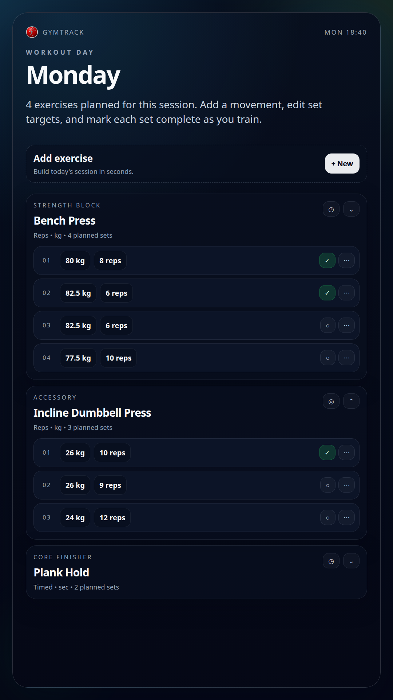
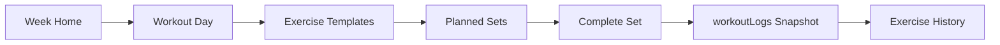

<p align="center">
  
</p>

<h1 align="center">GymTrack</h1>

<p align="center">
  A local-first workout tracking PWA for planning recurring gym days, reusing exercise templates, and logging completed sets as immutable snapshots.
</p>

<p align="center">
  <strong>React 19</strong> |
  <strong>TypeScript</strong> |
  <strong>Vite</strong> |
  <strong>React Router 7</strong> |
  <strong>Dexie</strong> |
  <strong>Tailwind CSS v4</strong> |
  <strong>PWA</strong>
</p>

<p align="center">
  
</p>

## Overview

GymTrack is built for one recurring problem in workout tracking: the values you plan for a day are not the same as the values you actually complete.

The app keeps reusable weekday templates in IndexedDB, lets you update those templates on the fly, and writes a dated snapshot log every time a set is completed. That gives you a fast planning flow for weekly training while preserving real history for each logged set.

> [!IMPORTANT]
> `workoutLogs` are append-only snapshot records. Changing a template later must never rewrite old history.

## Preview

| Week plan | Workout day |
| --- | --- |
|  |  |

## Quick Start

### Prerequisites

- Node.js
- Yarn

### Run locally

```bash
yarn install
yarn dev
```

### Available scripts

| Command | Purpose |
| --- | --- |
| `yarn dev` | Start the Vite development server |
| `yarn build` | Type-check and build the production bundle |
| `yarn lint` | Run ESLint |
| `yarn preview` | Preview the production build locally |
| `yarn pwa:icons` | Regenerate the favicon and installable app icons from `public/logo.svg` |
| `yarn pwa:screenshots` | Regenerate the PWA screenshot assets in `public/screenshots` |

> [!NOTE]
> GymTrack currently stores data locally in the browser using IndexedDB under the `GymTrack` database name. Clearing site data or switching browsers will reset that local history.

## How It Works

1. Open the weekly home screen and choose a weekday.
2. Add exercises to that day's template.
3. Add planned sets for reps-based or time-based work.
4. Reuse those planned values as the starting point for future workouts.
5. Complete sets during the workout to save dated snapshot logs.
6. Review exercise history to see what was actually completed.



## Product Rules

- Set inputs on the day screen are reusable template data.
- A set can be completed at most once per local calendar day.
- Completing a set stores the current values at that moment.
- Old logs must not change when template values change later.
- Exercise order is stored per day through `sortOrder`.
- Home-screen progress is intended to reset on a Sunday-to-Saturday weekly boundary.

## Feature Highlights

| Area | Behavior |
| --- | --- |
| Weekly planning | The home screen shows Sunday through Saturday with a summary for each day. |
| Reusable templates | Every exercise record stores a weekday template that can be reused on future weeks. |
| Two exercise modes | Templates support reps-based sets (`weight` + `reps`) and timed sets (`time`). |
| Mobile-first set UI | Sets render as stacked cards instead of table rows, with previous-performance context and a clear completion state. |
| Immutable history | Each completed set writes a dated snapshot to `workoutLogs`. |
| Offline support | The app registers a service worker and works as an installable PWA. |
| iOS install help | An iOS-only helper banner explains the manual `Add to Home Screen` flow when needed. |

## Routes

| Route | Purpose |
| --- | --- |
| `/` | Weekly home screen |
| `/days/:day` | Workout-day planner and template editor |
| `/exercises/:exerciseId/history` | Exercise history |

## Tech Stack

| Layer | Tools |
| --- | --- |
| Frontend | React 19, React Router 7, TypeScript |
| Styling | Tailwind CSS v4 and shared UI primitives in `src/shared/ui/*` |
| Storage | Dexie on top of IndexedDB |
| Build | Vite 8 |
| PWA | `vite-plugin-pwa`, service worker registration in `src/main.tsx` |
| Deployment | Netlify via `netlify.toml` |

## Storage Model

There is no separate workout-session table. Session history is inferred from dated set logs.

| Store | Purpose | Main fields |
| --- | --- | --- |
| `exercises` | One reusable exercise template per record | `id`, `day`, `sortOrder`, `title`, `exerciseType`, `exerciseUnit`, `plannedDurationMin`, `exerciseSets` |
| `exerciseSets` | Nested inside an exercise template | Stable `id`, plus either `weight` and `reps` or `time` |
| `workoutLogs` | One completed set per day | `id`, `exerciseId`, `exerciseSetId`, `completedAt`, `weight`, `reps`, `time` |

Additional behavior tied to the storage model:

- Previous performance in the set UI comes from the latest saved log for that specific set.
- Day-based completion uses local calendar boundaries from `getDayBounds()`.
- Undo removes that set completion for the current day.

## Project Structure

```text
src/
  app/
    AppLayout.tsx
    AppRouter.tsx
    db/
  features/
    exercise-history/
    exercises/
    pwa/
    week-plan/
  shared/
    constants/
    ui/
```

<details>
<summary><strong>Key entry points</strong></summary>

| Area | Main file |
| --- | --- |
| Router | `src/app/AppRouter.tsx` |
| App layout | `src/app/AppLayout.tsx` |
| Week home screen | `src/features/week-plan/screens/WeekPlanScreen.tsx` |
| Workout day screen | `src/features/exercises/screens/WorkoutDayScreen.tsx` |
| Add exercise form | `src/features/exercises/components/AddExerciseForm.tsx` |
| Exercise history | `src/features/exercise-history/screens/ExerciseHistoryScreen.tsx` |
| iOS install helper | `src/features/pwa/components/IosInstallPrompt.tsx` |
| Dexie client | `src/app/db/db.client.ts` |
</details>

## PWA Notes

- The service worker is registered in `src/main.tsx`.
- PWA manifest configuration and screenshot declarations live in `vite.config.ts`.
- Netlify caching and manifest/service-worker headers live in `netlify.toml`.
- Android browsers may show a native install prompt.
- iOS installation is manual through Safari using `Add to Home Screen`.

## Current Status

As of `2026-06-02`:

- `yarn build` passes.
- The repo is organized around `src/features/*`, `src/shared/*`, and `src/app/*`.
- There are no automated tests configured yet.

> [!WARNING]
> The current home-screen progress logic still does not fully match the intended Sunday-to-Saturday reset rule. The repo notes also call out a few product gaps: there is no UI for renaming exercises, there is no UI for reordering sets, and deleting an exercise or set currently deletes its related logs.

## Contributor Guardrails

- Keep `workoutLogs` append-only snapshot data.
- Do not mutate historical logs when template values change.
- Preserve day-scoped exercise ordering through `sortOrder`.
- Keep any future progress logic aligned to Sunday-to-Saturday week boundaries.
- If delete behavior changes, decide explicitly whether history should be preserved or removed.
