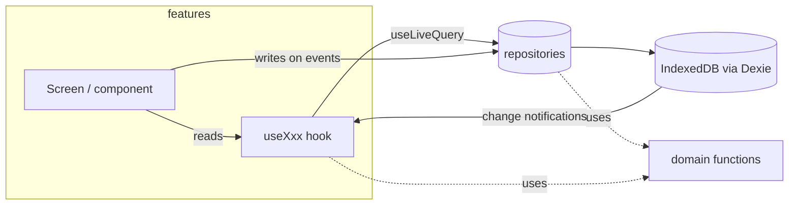
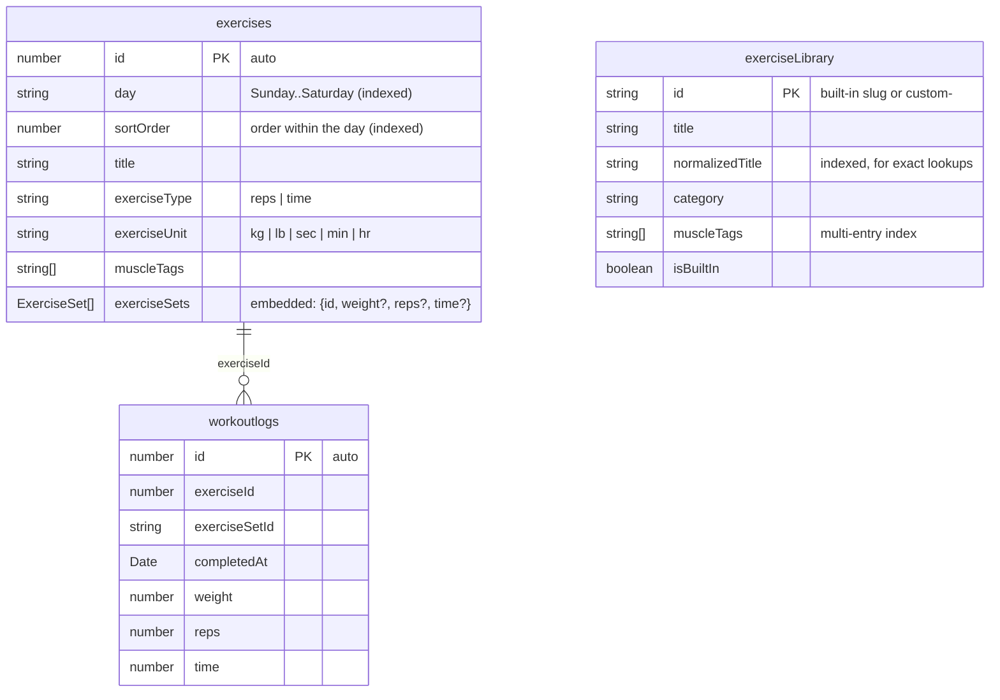

# Architecture

GymTrack is a client-only React app. There's no backend. All data lives in the browser's IndexedDB, and a service worker makes the app installable and fully offline.

This guide explains how the code is organised and why, how data moves through it, and the rules that keep it consistent.

- [Layers](#layers)
- [Folder layout](#folder-layout)
- [Data flow](#data-flow)
- [Data model](#data-model)
- [Domain rules](#domain-rules)
- [Routing and screens](#routing-and-screens)
- [PWA and offline](#pwa-and-offline)
- [Testing](#testing)
- [How to…](#how-to)

## Layers

The code is split into five layers. A layer may import from layers to its left, never from layers to its right.

```
shared  ←  domain  ←  data  ←  features  ←  app
```

| Layer | Folder | Contains | Must not |
| --- | --- | --- | --- |
| **shared** | `src/shared/` | Reusable UI primitives (`ui/`), the muscle-map SVG components (`muscle-map/`) and tiny helpers (`lib/`) | Know about workouts, the database or routes |
| **domain** | `src/domain/` | Types (`models/`) and pure logic: dates, set formatting, history, progress maths | Import React, Dexie or anything with side effects |
| **data** | `src/data/` | The Dexie database, its schema and migrations, repositories, and seed loaders | Import React or UI code |
| **features** | `src/features/*` | Screens, feature components and the hooks that connect them to data | Import another feature's internals (only its `index.ts`, e.g. `@/features/rest-timer`) |
| **app** | `src/app/` | Router, layout, navigation, theme, service-worker registration | Contain feature logic |

Why it's split this way:

- **Domain logic is pure,** so it's trivially unit-testable and easy to reason about. For example, `buildProgressSummary(exercises, logs)` takes plain arrays and returns plain data.
- **Only `src/data/` touches IndexedDB.** If storage ever changes (sync, a server, a different library), only the repositories change.
- **Features are self-contained,** so a screen can be rewritten without touching the others.

### Imports

- Within a module or feature, use relative paths (`./`, `../hooks/useProgress`).
- Across modules, use the `@/` alias, which points at `src/`: `import { db } from "@/data/db"`. The alias is defined in both `tsconfig.app.json` (`paths`) and `vite.config.ts` (`resolve.alias`).

## Folder layout

```text
src/
├─ main.tsx                    Bootstrap: apply theme, register SW, render router
├─ index.css                   Tailwind + design tokens (CSS variables, light/dark)
├─ app/
│  ├─ router.tsx               Routes (screens are lazy-loaded chunks)
│  ├─ AppLayout.tsx            Shell: <Outlet/>, navigation, iOS install prompt
│  ├─ AppNavigation.tsx        Bottom bar (mobile) / side rail (desktop)
│  ├─ TodayRedirect.tsx        "/" → /days/<today>
│  ├─ theme.ts                 System / dark / light preference
│  └─ pwa.ts                   Service-worker registration
├─ domain/                     Pure, framework-free
│  ├─ models/                  ExerciseTemplate, WorkoutSetLog, ExerciseLibraryItem
│  ├─ dates.ts                 Local day/week boundaries (weeks start Sunday)
│  ├─ weekdays.ts              WEEKDAYS, isWeekday, getTodayWorkoutDay
│  ├─ sets.ts                  "60 kg × 8" formatting, stepper increments
│  ├─ history.ts               Logs → sessions per day + best set
│  ├─ workout-day.ts           Day completion status
│  ├─ week-progress.ts         Per-weekday progress for the day strip
│  ├─ progress.ts              Progress tab statistics (Sunday–Saturday weeks)
│  └─ search.ts                Title normalisation
├─ data/
│  ├─ db.ts                    Dexie database + versioned migrations
│  ├─ backup.ts                Export / validate / restore the whole database as JSON
│  ├─ schema.ts                Index definitions
│  ├─ repositories/            The only API for reading/writing data
│  └─ seed/                    Loaders for public/data/*.json
├─ features/
│  ├─ workout-day/             Today screen: day strip, exercise rows, set logging
│  ├─ add-exercise/            Library search + one-tap add
│  ├─ exercise-detail/         Muscles, stats, history, settings for one exercise
│  ├─ progress/                Weekly statistics
│  ├─ rest-timer/              Countdown after each logged set (public API: index.ts)
│  ├─ settings/                Theme, rest time, backup export/import
│  └─ pwa/                     iOS "Add to Home Screen" helper
├─ shared/
│  ├─ ui/                      AppLogo, Card, IconButton, Panel, ProgressRing,
│  │                           ScreenHeader, SectionTitle, SegmentedControl, cn
│  ├─ muscle-map/              Body-map SVGs (see "Muscle map" below)
│  └─ lib/                     storage.ts (localStorage that never throws),
│                              createStore.ts + toast.ts (app-wide UI state),
│                              useWakeLock.ts (keep the screen on mid-workout)
└─ test/                       Test fixtures and the fresh-DB helper
```

Each feature follows the same anatomy:

```text
features/<name>/
├─ screens/      Route components (default export, lazy-loaded by the router)
├─ components/   Pieces used only by this feature
└─ hooks/        useXxx(): live reads + derived state for the screen
```

## Data flow



**Reads are live.** A feature hook wraps repository reads in `useLiveQuery` from `dexie-react-hooks`. Dexie tracks which tables and keys each query touched and re-runs it when they change. There's no global store, cache or manual refetching: when a repository write commits, every screen showing that data updates by itself.

**Writes are plain async calls.** Event handlers call repository functions directly, for example `logExerciseSetCompletion(exerciseId, set)`. The live queries pick up the change, so the UI never updates "optimistically" by hand.

**App-wide UI state** that isn't stored (the current toast, the running rest timer) lives in tiny module-level stores built with `shared/lib/createStore.ts` and read through `useSyncExternalStore`. Any code can call `showToast(...)` or `startRestTimer()`, and the bottom dock in `AppLayout` renders them, even across navigation.

**Derived data is computed by domain functions,** called from repositories (when they need the database to answer) or from hooks (when it's view state). One example is `getWorkoutDayStatus(exercises, completedSetIds)`.

Here's a concrete trace of completing a set:

1. `SetRow` ✓ button → `ExerciseRow.toggleDone()` → `logExerciseSetCompletion()` in `data/repositories/workout-log.repository.ts`.
2. The repository runs a transaction: if no log exists for that set today, it adds a snapshot of the set's current values.
3. Dexie notifies every live query that read `workoutLogs`:
   - `useWorkoutDay` (the ✓ fills in, the progress bar moves, the next exercise auto-opens),
   - `useWeekProgress` (the day-strip dot),
   - and, if open elsewhere, `useProgress` and `useExerciseHistory`.

### Feature hooks

| Hook | Feature | Returns |
| --- | --- | --- |
| `useWorkoutDay(day)` | workout-day | exercises, `completedSetIds` (today), `latestLogBySetId`, `status` |
| `useWeekProgress()` | workout-day | `Map<weekday, {totalSets, completedSets}>` for this week |
| `useExercisePicker(day)` | add-exercise | query/category state, results, recent, `add`, `createAndAdd` |
| `useExercise(id)` / `useExerciseHistory(ex)` | exercise-detail | the exercise (`undefined` loading, `null` missing); sessions + best set |
| `useProgress()` | progress | week navigation + `ProgressSummary` |

## Data model

The database is named **`GymTrack`**. Its schema lives in `src/data/schema.ts` and its migrations in `src/data/db.ts`.



| Table | What it is |
| --- | --- |
| `exercises` | **Templates.** One row per exercise on a weekday. Its `exerciseSets` are the values you plan to lift, and they are reused every week. |
| `workoutlogs` | **History.** One immutable snapshot per completed set per day. There's no session table; sessions are derived by grouping logs by date. |
| `exerciseLibrary` | **Catalogue** for search. 54 built-ins are seeded from `public/data/exerciseLibrary.json`; user-created customs live here too. |

Indexes worth knowing:

- `[exerciseId+completedAt]` answers "which sets of this exercise are done today?"
- `[exerciseSetId+completedAt]` answers "last time I did this set", and "is this set already logged today?"
- `completedAt` serves the Progress tab range queries and this week's day-strip progress.

## Domain rules

These are the product invariants. The tests in `src/**/*.test.ts` enforce most of them.

1. **Logs are snapshots.** Completing a set copies its current values into `workoutLogs`. Editing a template later never changes past logs.
2. **One completion per set per local day.** `logExerciseSetCompletion` checks and inserts in a single transaction, so a double tap can't log twice. Undo removes only that day's log.
3. **Deleting a set keeps its history.** Deleting a whole exercise removes its logs. Deletes happen immediately and show an **Undo** toast; the repository returns what it removed (`DeletedExercise`, the removed set and its index) so it can be put back exactly.
4. **Weeks run Sunday to Saturday** in local time (`startOfWeek`). Day-strip progress resets every Sunday.
5. **Exercise order is per day.** `sortOrder` is set when an exercise is added (appended) and changed only by move up/down.
6. **Seeding never overwrites.** Built-in exercises are inserted only if missing, so a user's edits survive app updates.
7. **New sets copy the previous set,** and adding a previously planned exercise reuses its last set values.

## Routing and screens

The routes are defined in `src/app/router.tsx`. Every screen is lazy-loaded, so it ships as its own JS chunk.

| Path | Screen |
| --- | --- |
| `/` | Redirects to `/days/<today>` |
| `/days/:day` | `workout-day/screens/WorkoutDayScreen` |
| `/days/:day/add-exercise` | `add-exercise/screens/AddExerciseScreen` |
| `/exercises/:exerciseId` | `exercise-detail/screens/ExerciseDetailScreen` |
| `/progress` | `progress/screens/ProgressScreen` |
| `/settings` | `settings/screens/SettingsScreen` |
| anything else | Redirects to `/` |

Screens validate their own URL params (`isWeekday(day)`, numeric ids) and render a short "doesn't exist" message instead of throwing.

### Muscle map

`src/shared/muscle-map/` draws body figures with targeted muscles highlighted.

- **`art/`** holds the SVG path data. Symmetric views are drawn as one half and mirrored.
- **`muscles.ts`** defines groups (chest, back, legs…) and their muscle ids.
- **`tagTargets.ts`** maps the app's free-text muscle tags (`"Upper Chest"`) to regions.
- **`MuscleFigure`** is the generic renderer. The app uses two components built on it, both exported from `index.ts`:
  - `MuscleThumbnail`: the main group in one view, for list rows.
  - `MuscleTargetsPreview`: every targeted group, on the exercise detail page.

Colours come from the CSS variables `--muscle-*` in `index.css`.

## PWA and offline

The PWA is built with `vite-plugin-pwa` in `generateSW` mode, configured in `vite.config.ts`.

- **Precache:** the JS/CSS/HTML bundle, the icons and `data/*.json` (the exercise library), so the app works offline from its first visit. Screenshots are excluded on purpose.
- **Updates:** `registerType: "autoUpdate"`. A new deploy activates on the next load, because `index.html`, `sw.js` and the manifest are served `no-cache` (see `netlify.toml`).
- **Registration:** `src/app/pwa.ts`. It's disabled in `yarn dev` to avoid stale caches while developing.
- **iOS** has no install prompt, so `features/pwa/IosInstallPrompt` explains "Share → Add to Home Screen".

**Backups:** Settings → Export writes the whole database to a JSON file (`data/backup.ts`), using the share sheet on phones and a download on desktop. Import validates the file, asks for confirmation and replaces everything in one transaction.

**Keeping the screen on:** while today's workout has unfinished sets, `useWakeLock` holds a Screen Wake Lock and re-acquires it when the app returns to the foreground. Unsupported browsers simply ignore it.

The theme preference is stored in `localStorage` through `shared/lib/storage.ts`, which never throws, and is applied before first paint in `main.tsx`.

## Testing

```bash
yarn test         # once
yarn test:watch   # watch mode
yarn verify       # typecheck + lint + tests
```

- **Vitest** runs in a Node environment (`vitest.config.ts`). Tests are colocated as `*.test.ts`.
- **Domain tests** cover pure functions with fixtures from `src/test/fixtures.ts`. Use `at(y, m, d, h)` for local-time dates.
- **Repository tests** run real Dexie against `fake-indexeddb` (an in-memory IndexedDB). Call `resetDatabaseBeforeEach()` from `src/test/db.ts` at the top of the file.
- UI components aren't unit-tested. Keep logic out of them and in domain functions or hooks, where it can be tested.

## How to…

**Add a screen**

1. Create `src/features/<name>/screens/<Name>Screen.tsx` with a default export.
2. Put its reads in `hooks/use<Name>.ts`.
3. Add a lazy route in `src/app/router.tsx`, plus a nav item in `AppNavigation.tsx` if it's a tab.

**Add a field or index to stored data**

1. Update the type in `src/domain/models/`.
2. If it needs an index, add a new schema constant in `src/data/schema.ts`.
3. Add `this.version(N + 1).stores({...})` in `src/data/db.ts`, with an `.upgrade(tx => …)` if existing rows need backfilling. Never edit an existing version.
4. Write a repository test for the new behaviour.

**Add a muscle region**

1. Add the id to a group in `shared/muscle-map/muscles.ts`, with a label.
2. Draw its shape in the relevant `art/*.ts` view.
3. Map any app tags to it in `tagTargets.ts`.

**Add a built-in exercise**

Append it to `public/data/exerciseLibrary.json` with a new unique `id`. Existing users receive it automatically on their next visit to Add Exercise, because seeding inserts only missing ids.
